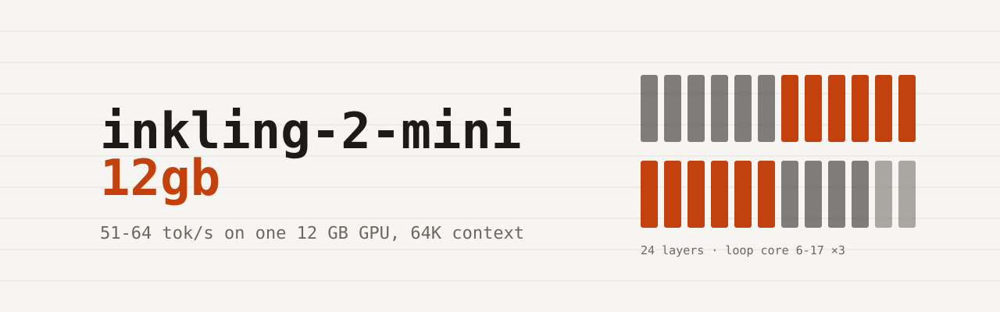

<p align="center">
  <picture>
    <source media="(prefers-color-scheme: dark)" srcset=".github/assets/banner-dark.svg">
    
  </picture>
</p>

<p align="center">Run Inkling 2 Mini on one 12 GB GPU with a llama.cpp fork and a mixed 2-3 bit GGUF.</p>

<p align="center">
  <a href="https://huggingface.co/hridya423/Inkling-2-Mini-12GB-GGUF">Model</a> · <a href="https://github.com/hridaya423/llama.cpp/tree/inkling-fast">llama.cpp fork</a> · <a href="https://github.com/hridaya423/llama.cpp/releases/tag/inkling-fast-4d46c81b8">Windows build</a> · <a href="https://github.com/hridaya423/llama.cpp/blob/inkling-fast/docs/inkling2-fast.md">Technical notes</a>
</p>

[Inkling 2 Mini](https://huggingface.co/thinkingmachines/Inkling-2-Mini) does not fit on a 12 GB card at usable quality with upstream llama.cpp. This setup fits it, with 64K context, and keeps 90.9% of the top tokens of Q8_0. You need two parts: the `inkling-fast` build of llama.cpp and the mixB GGUF.

| Setup on an RTX 4070 Ti 12 GB, 64K context | Decode, 22K prompt | Decode, short prompt | Prompt processing | Same top token as Q8_0 |
|---|---|---|---|---|
| upstream llama.cpp, ggml-org IQ4_NL, part of the experts on the CPU | 29-34 tok/s | 29-34 tok/s | 88 tok/s | 95.7% |
| **`inkling-fast` build, mixB GGUF** | 51-53 tok/s | 61-64 tok/s | ~1500 tok/s | 90.9% |

The quality numbers come from `llama-perplexity --kl-divergence` against Q8_0 on 50 chunks of 512 tokens of wikitext-2. The speed numbers come from `llama-server` on Windows with CUDA 12.4.

## Requirements

- An NVIDIA GPU with 12 GB of VRAM. If the desktop also uses the GPU, keep other GPU programs closed.
- 12 GB of disk space for the download.

## Install

### 1. Get llama.cpp

> [!IMPORTANT]
> Upstream llama.cpp cannot load the mixB GGUF. Use the `inkling-fast` build.

On Windows with an RTX 40 series GPU, download the two zip files from the [release](https://github.com/hridaya423/llama.cpp/releases/tag/inkling-fast-4d46c81b8). Extract both into the same folder. The release CUDA kernels are for sm_89 only.

On other GPUs or on Linux, build from source:

```sh
git clone -b inkling-fast https://github.com/hridaya423/llama.cpp
cd llama.cpp
cmake -B build -DGGML_CUDA=ON -DCMAKE_BUILD_TYPE=Release
cmake --build build --config Release -j
```

### 2. Get the model

```sh
hf download hridya423/Inkling-2-Mini-12GB-GGUF --local-dir Inkling-2-Mini-12GB
```

The download is the 10.3 GiB model and the 0.6 GiB vision projector.

## Run

```sh
llama-server -m Inkling-2-Mini-12GB/Inkling-2-Mini-mixB.gguf \
  --mmproj Inkling-2-Mini-12GB/mmproj-Inkling-2-Mini-BF16.gguf --no-mmproj-offload \
  -ngl 99 -fa on --jinja -c 65536 -b 512 -ub 512 -ctk q8_0 -ctv q8_0 -t 8 -np 1 \
  -ot "blk\.(22|23)\.ffn_.*_exps=CPU"
```

The server listens on `http://127.0.0.1:8080` with an OpenAI-compatible API. Chat, tool calls, image input and prompt caching work. The server uses 11.6 GB of VRAM, including the Windows desktop.

| Flag | Reason |
|---|---|
| `-ot "blk\.(22\|23)\.ffn_.*_exps=CPU"` | Puts the IQ4_NL experts of the last two layers on the CPU, so the rest fits on the GPU. |
| `-c 65536 -ub 512` | The largest context and ubatch that fit. `-ub 1024` at 64K overflows VRAM. |
| `-ctk q8_0 -ctv q8_0` | An f16 KV cache does not fit at 64K. |
| `--no-mmproj-offload` | Keeps the vision projector off the GPU. |

> [!WARNING]
> If VRAM use goes near 12 GB, the Windows driver moves memory to system RAM without an error. Then decode and prompt processing slow down a lot. Check `nvidia-smi` after you change `-c` or `-ub`.

## How it works

The `inkling-fast` branch makes three changes:

- `llama-quantize --pad-exps` zero-pads the expert down tensors from 1152 to 1280 columns. Without padding, every IQ2 and IQ3 type falls back to IQ4_NL.
- A fused relative-position bias in CUDA flash attention cuts the 64K compute buffer from 6.5 GB to about 1 GB.
- New ops and CUDA fusions reduce the kernels per token from about 5000 to about 3500. On the same GGUF, decode goes from 54 to 64 tok/s.

The mixB GGUF gives more bits to the loop core (layers 6-17), because those layers run three times per token. The [technical notes](https://github.com/hridaya423/llama.cpp/blob/inkling-fast/docs/inkling2-fast.md) have the quant recipe and the setups that did not help.
